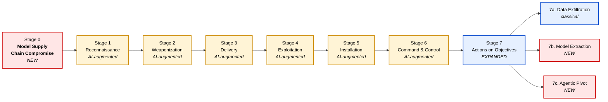

# Extended Cyber Kill Chain for AI-Era Threats

An update to the Lockheed Martin Cyber Kill Chain for defenders working against LLM and agentic AI attacks. Adds a pre-attack stage for model supply chain compromise. Adds AI-specific sub-techniques to each of the original seven stages. Splits the Actions on Objectives stage into three peer sub-stages: classical data exfiltration, model extraction, and agentic pivot.

[](./CHANGELOG.md)
[](./LICENSE)
[](./CHANGELOG.md)
[](https://github.com/gouravnagar-infosec/ai-kill-chain/actions/workflows/validate.yml)
[](https://doi.org/10.5281/zenodo.20349357)

Author: Gourav Nagar
Version: 1.1
Date: November 8, 2026
Repository: https://github.com/gouravnagar-infosec/ai-kill-chain

Cite as: Nagar, G. (2026). *Extended Cyber Kill Chain for AI-Era Threats* (Version 1.1). Zenodo. https://doi.org/10.5281/zenodo.20349357

## Table of contents

1. [Abstract](#abstract)
2. [Background](#background)
3. [Why the seven-stage model is not enough](#why-the-seven-stage-model-is-not-enough)
4. [The framework at a glance](#the-framework-at-a-glance)
5. [Stage-by-stage specification](#stage-by-stage-specification)
   - [Stage 0. Model Supply Chain Compromise (new)](#stage-0-model-supply-chain-compromise-new)
   - [Stage 1. Reconnaissance (AI-augmented)](#stage-1-reconnaissance-ai-augmented)
   - [Stage 2. Weaponization (AI-augmented)](#stage-2-weaponization-ai-augmented)
   - [Stage 3. Delivery (AI-augmented)](#stage-3-delivery-ai-augmented)
   - [Stage 4. Exploitation (AI-augmented)](#stage-4-exploitation-ai-augmented)
   - [Stage 5. Installation (AI-augmented)](#stage-5-installation-ai-augmented)
   - [Stage 6. Command and Control (AI-augmented)](#stage-6-command-and-control-ai-augmented)
   - [Stage 7. Actions on Objectives (expanded)](#stage-7-actions-on-objectives-expanded)
6. [Agentic sub-techniques added in v1.1](#agentic-sub-techniques-added-in-v11)
7. [Relationship to MITRE ATLAS, OWASP, NIST AI RMF](#relationship-to-mitre-atlas-owasp-nist-ai-rmf)
8. [Worked case studies](#worked-case-studies)
9. [Detection and mitigation guidance](#detection-and-mitigation-guidance)
10. [Machine-readable data](#machine-readable-data)
11. [Originality statement](#originality-statement)
12. [How to cite](#how-to-cite)
13. [References](#references)
14. [License](#license)

## Abstract

The Lockheed Martin Cyber Kill Chain has been the working model for how defenders describe an intrusion campaign since 2011. Seven stages from reconnaissance to actions on objectives. Network and endpoint attack surface. Human attackers operating tools against deterministic targets. Its value to defenders is the disruption logic: block any one stage and the rest of the chain cannot complete.

LLMs and AI agents do not fit that picture. Attackers now target model weights, training data, system prompts, tool descriptions. A document or a web page can carry instructions that an AI agent will execute as if a user had typed them. Agents with tool access can pivot through legitimate trust relationships without ever loading shellcode.

MITRE ATLAS and OWASP both catalog these threats. ATLAS v2026.10 (October 2026) has 16 tactics, 129 techniques, 92 sub-techniques, and 77 case studies, with coverage that reaches into indirect prompt injection, agentic command and control, and autonomous attack agents. OWASP's 2025 LLM Top 10 prioritizes ten risk categories for application builders, and its Top 10 for Agentic Applications (December 2025) adds ten more for systems that plan, call tools, and act. All three are organized as matrices or risk lists. None is a kill chain.

This document is the kill-chain-shaped view of the same content. It is written for SOC analysts and detection engineers who already think in kill chain stages.

It does three things on top of the canonical seven. It adds a new pre-attack stage (Stage 0) for adversary activity against the AI supply chain itself. It adds AI-specific sub-techniques inside each of the original seven stages, with EKC IDs so detection rules and SOC playbooks can reference them. And it splits Stage 7 (Actions on Objectives) into three peer sub-stages: classical data exfiltration, model extraction, and agentic pivot.

This is not a replacement for ATLAS or OWASP. It is the kill-chain-shaped view of the same threat surface.

## Background

The original Cyber Kill Chain, from Hutchins, Cloppert, and Amin's 2011 Lockheed Martin paper, breaks an intrusion into seven stages.

| Stage | Name | What the adversary is doing |
|-------|------|------------------------------|
| 1 | Reconnaissance | Picking targets |
| 2 | Weaponization | Pairing an exploit with a payload |
| 3 | Delivery | Getting the weapon to the target |
| 4 | Exploitation | Triggering it |
| 5 | Installation | Implanting persistence |
| 6 | Command and Control | Establishing a control channel |
| 7 | Actions on Objectives | Achieving the mission |

The model is the basis of more than a decade of detection engineering practice, threat intel reporting structure, and SOC playbook design. A book-length treatment of the framework and its operational use is Nagar and Kumar (2025), *Cyber Security Kill Chain: Tactics and Strategies* (Packt). This framework extends that book.

## Why the seven-stage model is not enough

The original assumptions break in four places for AI-era attacks.

Attacks now have a pre-network stage. A poisoned dataset or a compromised pre-trained model sitting on a public registry can compromise a target organization before any packet crosses a firewall. The canonical kill chain starts at Reconnaissance and has nowhere to put this.

Prompts mix code and data. LLMs cannot reliably tell instructions apart from content. Hidden text in a web page, an email, or a tool description can become instructions the model follows. What the kill chain treats as separate Delivery and Exploitation stages collapses into a single primitive in the AI case: indirect prompt injection.

Models themselves are targets now. Adversaries want the weights, the fine-tuning data, the system prompts, the capabilities encoded in deployed models. "Data exfiltration" understates this. Model extraction, training-data extraction, capability mining each have different mechanics and need different defenses.

And agents pivot through their own permissions. A compromised AI agent with tool access (MCP, function calling, browser control) does not need to escalate privileges or load shellcode. It invokes the tools it is already allowed to use. The mechanics are not classical lateral movement, but the effect on a target environment is.

ATLAS has been catching up. v4.9.0 (April 2025) added Command and Control as a tactic (AML.TA0014). v5.1.0 (November 2025) added Lateral Movement (AML.TA0015). By v2026.10 (October 2026) ATLAS is a 16-tactic matrix with strong coverage of agentic threats, including case studies for SesameOp (AML.CS0042), OpenClaw (AML.CS0050, AML.CS0051), poisoned MCP servers (AML.CS0053, AML.CS0054), and agent-run intrusions (AML.CS0071, AML.CS0073). This framework does not exist to fill gaps in ATLAS; ATLAS works as a matrix. It exists because the same content needs to be available to defenders who reason in kill-chain stages, with the original stage disruption logic still doing the work.

## The framework at a glance



Red is new, yellow is original with AI sub-techniques, blue is original but structurally expanded.

The framework adds three things to the seven-stage original. A new pre-attack Stage 0 sits in front of Reconnaissance to cover adversary activity against the AI supply chain. Each original stage picks up its own AI-specific sub-techniques with EKC IDs, so detection rules and threat reports can reference them. Stage 7 splits into three peer sub-stages: classical exfiltration stays in place as 7a, with Model Extraction (7b) and Agentic Pivot (7c) added next to it. These are not variants of exfiltration. They are distinct adversary objectives that need their own controls.

## Stage-by-stage specification

Each stage spec below covers four things. What the adversary is doing. The AI-specific sub-techniques (with `EKC` IDs that can be cited in detection rules and threat reports). The detection signals a defender can act on. The mitigations.

### Stage 0. Model Supply Chain Compromise (new)

**What the adversary is doing.** Compromising a model, dataset, fine-tuning adapter, or distribution channel that the target organization will pull into its own AI systems later. The adversary never touches the target's network. They put the compromise into the supply chain and wait.

**Sub-techniques.**

| ID | Sub-technique | Description |
|----|---------------|-------------|
| EKC-0.1 | Training data poisoning | Inject manipulated examples into a public dataset, web-scraped corpus, or labeling pipeline that future training runs will ingest. |
| EKC-0.2 | Fine-tuning backdoor | Distribute a fine-tuning adapter, LoRA, or full-model checkpoint with a hidden trigger-and-behavior pair. |
| EKC-0.3 | Pre-trained model trojan | Publish a malicious model to a public registry (Hugging Face, Ollama Library, GitHub) under a plausible name or by typosquatting a real one. |
| EKC-0.4 | Tokenizer or preprocessing manipulation | Alter tokenization, normalization, or feature-extraction code in an upstream dependency to add a covert input channel. |
| EKC-0.5 | Malicious MCP server or tool catalog entry | Publish a tool description, MCP server manifest, or function definition designed to be invoked by downstream agents and exploit them through prompt injection in the tool description itself. |

**Detection signals.**
- Provenance gaps in deployed model artifacts (no signed manifest, no known training-data lineage).
- Cryptographic hash drift between a model pulled from a registry today and the same identifier pulled at a prior date.
- Tool descriptions from third-party MCP servers that contain unusually long, instruction-like text or non-printable characters.
- Anomalous neuron-activation distributions in a deployed model when probed with a curated trigger suite.

**Primary mitigations.**
- Keep a model bill of materials (M-BOM) for every deployed model, including base model identity, fine-tuning data hashes, and adapter provenance.
- Sign and verify model artifacts. Pin specific commit hashes for registry-hosted models.
- Quarantine and sandbox newly added MCP servers. Review tool descriptions as untrusted input.
- Routine backdoor-trigger scanning against deployed models using published benchmarks.

### Stage 1. Reconnaissance (AI-augmented)

**What the adversary is doing.** Finding the target's AI systems, what they can do, what their guardrails are, and what they connect to.

**AI-augmented sub-techniques.**

| ID | Sub-technique | Description |
|----|---------------|-------------|
| EKC-1.1 | Model fingerprinting | Identify the base model, fine-tune family, and version of a deployed LLM through response-style probing, latency analysis, or known-answer tests. |
| EKC-1.2 | System prompt enumeration | Use leakage queries, role-play probes, or boundary-case prompts to recover the system prompt or its main constraints. |
| EKC-1.3 | Capability and tool enumeration | Discover which tools, plugins, MCP servers, or function-call interfaces the agent has access to. |
| EKC-1.4 | Guardrail mapping | Map the policy boundary by probing refusal patterns and finding topics, formats, or input shapes that bypass classifiers. |
| EKC-1.5 | Embedding and retrieval surface discovery | Identify which retrieval sources the system reads from (vector store contents, document corpora, web fetch domains). |
| EKC-1.6 | Peer agent and Agent Card enumeration | Map the remote agents the target can delegate to, and the skills, endpoints, and auth schemes their Agent Cards advertise. [Detail](#ekc-16-peer-agent-and-agent-card-enumeration). |

**Detection signals.** High-entropy prompt sessions from a single source. Systematic exploration of refusal boundaries. Queries that closely match published jailbreak corpora. Repeated requests for the system to "repeat the instructions above."

**Primary mitigations.** Rate-limit and behavior-cluster prompt traffic per user identity. Redact identifying response artifacts. Add canary tokens to the system prompt that fire on exfiltration. Restrict tool enumeration to authenticated, audited callers.

### Stage 2. Weaponization (AI-augmented)

**What the adversary is doing.** Building a payload that will be delivered to the target.

**AI-augmented sub-techniques.**

| ID | Sub-technique | Description |
|----|---------------|-------------|
| EKC-2.1 | Adversarial prompt crafting | Build a prompt-injection payload tailored to the fingerprinted target model, guardrails, and toolset from Stage 1. |
| EKC-2.2 | Multi-modal payload construction | Embed instructions in images, audio, PDFs, or structured documents that a multi-modal model will parse. |
| EKC-2.3 | Malicious tool or MCP package | Build a tool that looks benign in name and description but executes attacker-controlled actions when invoked. |
| EKC-2.4 | Jailbreak chain assembly | Combine known bypass techniques (persona priming, encoding tricks, low-resource language pivots, structured role-play) into a single payload that defeats layered guardrails. |
| EKC-2.5 | AI-generated polymorphic malware | Use a model to produce semantically equivalent but lexically diverse malware variants that evade signature-based detection. |

**Detection signals.** Pattern matches against known indirect-injection markers in inbound content. Image, PDF, and audio analysis for steganographic instructions. Static analysis of newly registered MCP packages.

### Stage 3. Delivery (AI-augmented)

**What the adversary is doing.** Getting the payload to the AI system or its operator.

**AI-augmented sub-techniques.**

| ID | Sub-technique | Description |
|----|---------------|-------------|
| EKC-3.1 | Indirect prompt injection via web content | A browsing or web-fetching agent retrieves an attacker-controlled page with instructions in it. |
| EKC-3.2 | RAG corpus poisoning | An attacker submits content (via support tickets, public docs, code contributions, or vector-store ingestion) that will later be retrieved as context for an LLM. |
| EKC-3.3 | Email or message-borne injection | Instructions placed in an email that an AI assistant is configured to read or summarize. |
| EKC-3.4 | Document-borne injection | Instructions placed in PDFs, spreadsheets, or office documents processed by an AI workflow. |
| EKC-3.5 | Tool-description poisoning | Instructions placed in the descriptions or schemas of MCP tools or function definitions exposed to the agent. |
| EKC-3.6 | Image, audio, or QR-code injection | Instructions encoded in non-text modalities that a multi-modal agent will process. |
| EKC-3.7 | Crafted assistant link delivery | A link or "Summarize with AI" button opens the user's assistant with an attacker-written prompt already filled in. [Detail](#ekc-37-crafted-assistant-link-delivery). |
| EKC-3.8 | Malicious or impersonated peer agent | The payload arrives as the response of a remote agent the target delegates to, one the attacker runs or impersonates. [Detail](#ekc-38-malicious-or-impersonated-peer-agent). |
| EKC-3.9 | Interface-layer injection against computer-use agents | Instructions placed in what a computer-use or browser agent sees on screen: fake dialogs, ClickFix steps, hidden text, AI-only page variants. [Detail](#ekc-39-interface-layer-injection-against-computer-use-agents). |

**Detection signals.** Anomalous instruction-like text in untrusted content streams. High entropy in image alpha channels and metadata for multi-modal pipelines. Unexpected language shifts inside retrieved documents.

### Stage 4. Exploitation (AI-augmented)

**What the adversary is doing.** Triggering the payload. In AI terms: getting the model to follow the attacker's instructions or violate its policy.

**AI-augmented sub-techniques.**

| ID | Sub-technique | Description |
|----|---------------|-------------|
| EKC-4.1 | Direct prompt injection success | The user-facing prompt achieves the attacker's policy violation. |
| EKC-4.2 | Indirect prompt injection success | Instructions delivered via Stage 3 are followed by the model when the content is processed. |
| EKC-4.3 | Confused-deputy tool invocation | The model invokes a privileged tool on behalf of the attacker, using the agent's own permissions. |
| EKC-4.4 | Guardrail or classifier bypass | A safety classifier or rule-based filter is evaded such that disallowed content is produced or disallowed actions are taken. |
| EKC-4.5 | Memory or context pollution | A persistent memory store is updated with attacker-controlled content that will influence future sessions. |
| EKC-4.6 | Computer-use action hijack | The agent carries out the attacker's steps as clicks, keystrokes, file:// reads, or shell commands on the user's machine. [Detail](#ekc-46-computer-use-action-hijack). |

**Detection signals.** Tool invocations whose arguments derive from untrusted input strings. Outputs that include canary tokens from the system prompt. Large-step deviations in conversation state caused by a single retrieved document.

### Stage 5. Installation (AI-augmented)

**What the adversary is doing.** Setting up persistence so the compromise survives a single session.

**AI-augmented sub-techniques.**

| ID | Sub-technique | Description |
|----|---------------|-------------|
| EKC-5.1 | Persistent memory implant | Inject content into long-term memory, user preference stores, or per-account context that will be reloaded in future sessions. |
| EKC-5.2 | System prompt override | Modify a custom GPT, assistant configuration, or agent definition to embed attacker instructions in its system prompt. |
| EKC-5.3 | Malicious connector installation | Cause a user or admin to install an attacker-controlled MCP server, plugin, or browser extension that gives the attacker a persistent foothold. |
| EKC-5.4 | RAG corpus persistence | Ensure poisoned documents stay in the vector store across re-indexing operations. |
| EKC-5.5 | Stored skill or workflow contamination | Modify a stored skill, automation, or saved workflow that the agent will load and execute on a schedule or on demand. |
| EKC-5.6 | Shared agent memory poisoning | Poison a memory store that many users or agents read, so one write influences every session that loads it. [Detail](#ekc-56-shared-agent-memory-poisoning). |

**Detection signals.** New entries in memory stores not attributable to a legitimate user action. Unauthorized changes to system prompts, custom GPTs, or saved skills. Newly registered MCP endpoints. Vector-store ingestion events outside expected pipelines.

### Stage 6. Command and Control (AI-augmented)

**What the adversary is doing.** Holding an interactive or scheduled channel that lets them direct further activity.

AI agents introduce new C2 channels. ATLAS now covers some of these (for example, AI Service API AML.T0096; the SesameOp case study AML.CS0042 documents the OpenAI Assistants API being used as C2 infrastructure). The sub-techniques below organize the same phenomena as kill-chain stages.

**AI-augmented sub-techniques.**

| ID | Sub-technique | Description |
|----|---------------|-------------|
| EKC-6.1 | LLM channel as C2 | Encode commands in seemingly benign user prompts, retrieved documents, or tool outputs that the agent reads on a schedule. |
| EKC-6.2 | Memory-mediated C2 | Use the agent's long-term memory store as a dead-drop. The attacker writes instructions to memory through one entry point, the agent acts on them through another. |
| EKC-6.3 | RAG-mediated C2 | Update a poisoned document in the vector store to deliver new instructions. The agent retrieves them on the next relevant query. |
| EKC-6.4 | Tool-output C2 | A compromised MCP server returns instruction-laden responses on each invocation, steering the agent's subsequent behavior. |
| EKC-6.5 | Cross-session steganographic C2 | Encode command payloads in fields the agent passes between sessions (user notes, project descriptions, ticket comments) where they evade content classification because each fragment looks innocuous on its own. |
| EKC-6.6 | Inter-agent session smuggling | A malicious remote agent uses an open multi-turn session to feed the client agent extra instructions mid-task. [Detail](#ekc-66-inter-agent-session-smuggling). |

**Detection signals.** Conversation-graph analysis showing instructions repeatedly arriving from the same retrieved source. Outputs from external tools containing imperative language inconsistent with the tool's documented purpose. Entropy analysis on agent-to-agent fields.

### Stage 7. Actions on Objectives (expanded)

**What the adversary is doing.** Achieving the mission. Stage 7 splits into three peer sub-stages because AI systems make two new classes of objective viable that did not previously exist as first-class targets.

#### Sub-stage 7a. Data Exfiltration (classical)

The traditional kill chain's actions on objectives. Sensitive data is exfiltrated. Systems are destroyed, encrypted, or impaired. Fraud is committed. AI does not change this sub-stage qualitatively. It amplifies the scale through cheaper phishing, automated reconnaissance, and faster social-engineering loops.

#### Sub-stage 7b. Model Extraction (new)

The target is the model itself, the data inside it, or the knowledge encoded in it.

| ID | Sub-technique | Description |
|----|---------------|-------------|
| EKC-7b.1 | API-based model extraction | Reconstruct an approximation of a deployed model's weights or decision boundary by querying it at scale and training a surrogate. |
| EKC-7b.2 | Training-data extraction | Recover verbatim or near-verbatim training examples, including sensitive PII or proprietary content, through memorization-targeting prompts. |
| EKC-7b.3 | Membership inference | Determine whether a specific record was in the training set. Has downstream implications for privacy regulation and confidentiality. |
| EKC-7b.4 | System prompt and instruction extraction | Recover proprietary system prompts that encode business logic, pricing rules, or competitive positioning. |
| EKC-7b.5 | Capability mining | Use the deployed model to perform tasks the attacker's own infrastructure cannot. The access becomes a capability transfer. |

**Detection signals.** High-volume programmatic query patterns from a single identity, especially with low entropy in query templates and high entropy in inputs. Queries that contain classical memorization probes ("repeat the text above"). Query distributions that resemble published extraction attacks.

#### Sub-stage 7c. Agentic Pivot (new)

The compromised AI agent is used to take actions in connected systems, using its own legitimate permissions. Mechanically, EKC-7c.1 to EKC-7c.5 involve no exploit code, no credential reuse, no privilege escalation. Only invocation of authorized tools with attacker-influenced arguments. EKC-7c.6, added in v1.1, works differently. The credentials the agent holds are lifted and used outside it, and from then on the attacker does not need the agent at all. ATLAS added a Lateral Movement tactic (AML.TA0015) in v5.1.0 (November 2025) to address the same phenomenon. The contribution here is putting the agentic-pivot variant inside the Actions on Objectives stage of the kill chain, as a peer of classical exfiltration, rather than as a separate tactic earlier in the matrix.

| ID | Sub-technique | Description |
|----|---------------|-------------|
| EKC-7c.1 | Tool-mediated lateral action | The agent invokes legitimate tools (email send, file write, ticket creation, payment authorization) on behalf of the attacker. |
| EKC-7c.2 | Cross-app pivot | The agent moves from one connected application to another (calendar to CRM to payment processor) by chaining tool calls. |
| EKC-7c.3 | Identity confusion attack | The agent acts in a context where downstream systems treat its actions as the actions of a privileged user, granting privileges the attacker does not directly hold. |
| EKC-7c.4 | Recursive agent abuse | A compromised agent invokes other agents, propagating the compromise across an agent fabric without classical lateral movement. |
| EKC-7c.5 | Workflow weaponization | A stored automation or scheduled workflow runs the attacker's intended action on a recurring basis. |
| EKC-7c.6 | Agent credential and token theft | Lift the OAuth tokens, API keys, or secrets an agent holds or brokers, and use them outside the agent. [Detail](#ekc-7c6-agent-credential-and-token-theft). |

**Detection signals.** Tool calls whose arguments contain content traceable to untrusted upstream sources. Tool-call graphs that cross trust boundaries that no human action did. Spikes in cross-application calls per session. Outbound communications initiated by agents to recipients not in any prior conversation history. Agent-issued tokens used from networks or user agents the agent never runs from.

## Agentic sub-techniques added in v1.1

v1.0 was written when most production agents were a chat model with a handful of tools. By late 2026 the common deployment looks different. Agents keep long-term memory that other users and agents read. They delegate to other agents over protocols like A2A. They hold OAuth tokens for the user's SaaS apps through MCP. And computer-use agents drive a real browser or desktop. Each of those changes has public research or incident reporting behind it from the last twelve months, and each shows up in OWASP's Agentic Top 10, in ATLAS, or both.

v1.1 adds eight sub-techniques for them. None needed a new stage, which is a fair test of the framework's central claim. They fit inside the existing seven.

| Theme | New IDs | Where they sit |
|---|---|---|
| Agent memory poisoning | EKC-3.7, EKC-5.6 | Delivery through a prefilled assistant link, persistence in memory many principals share |
| Agent-to-agent protocol abuse | EKC-1.6, EKC-3.8, EKC-6.6 | Peer discovery, an impersonated or malicious peer, instructions smuggled into an open session |
| Agent credential and token theft | EKC-7c.6 | Tokens and secrets lifted out of the agent and used elsewhere |
| Computer-use agent attacks | EKC-3.9, EKC-4.6 | Payloads placed in what the agent sees on screen, and the agent operating the machine for the attacker |

The detail below is generated from [`data/ekc.yaml`](./data/ekc.yaml). Example Sigma rules for most of these IDs are in [`detections/`](./detections/).

<!-- BEGIN GENERATED: new-in-version -->
<!-- Generated by tools/build.py from data/ekc.yaml. Edit the YAML, not this table. -->

### EKC-1.6. Peer agent and Agent Card enumeration

**Stage 1 (Reconnaissance).** Enumerate the remote agents a target agent can delegate to, and the skills, endpoints, auth schemes and extended capabilities those agents advertise. In A2A deployments the public Agent Card sits at a well-known path and an authenticated extended card can expose more. The output is a map of which peer the attacker should impersonate, poison, or route through.

**Detection signals.**
- Bulk or sequential requests for /.well-known/agent-card.json across many hosts from one source.
- Extended Agent Card requests from identities that never send tasks afterwards.
- Agent Card fetches for internal agents from outside the network ranges that normally call them.

**Mitigations.**
- Keep the public Agent Card to what an unauthenticated caller needs. Put additional skills in the extended card, which A2A v1.0 says must require authentication, and keep internal service URLs and credentials out of both cards, as the specification advises.
- Return extended-card content per caller. The specification requires agents to check a client's permissions before returning privileged information.
- Rate-limit and log card retrieval like any other discovery endpoint.

**Cross-references.** ATLAS [AML.T0133](https://atlas.mitre.org/techniques/AML.T0133) Discover AI Agent Runtime Capabilities, [AML.T0084.003](https://atlas.mitre.org/techniques/AML.T0084.003) Discover AI Agent Configuration: Call Chains, [AML.T0002.002](https://atlas.mitre.org/techniques/AML.T0002.002) Acquire Public AI Artifacts: AI Agent Configuration. OWASP Agentic ASI07 Insecure Inter-Agent Communication.

**Sources.** <https://github.com/a2aproject/A2A/blob/v1.0.0/docs/specification.md>

### EKC-3.7. Crafted assistant link delivery

**Stage 3 (Delivery).** Deliver a payload as a link that opens an AI assistant with an attacker-written prompt already filled in (for example through a ?q= or ?prompt= URL parameter), often behind a "Summarize with AI" button or in an email. One click replaces the user's own prompt with the attacker's. When the prompt tells the assistant to remember a source as trusted, the delivery doubles as a memory write.

**Detection signals.**
- URLs pointing at assistant domains whose prompt parameter contains memory or trust language ("remember", "trusted source", "in future conversations", "authoritative").
- The same prefilled-prompt template showing up across inbound email from unrelated senders.
- A memory write in the assistant within seconds of the user opening such a link.

**Mitigations.**
- Hunt for prefilled-prompt links in mail, chat and proxy logs. Microsoft published starter queries for this in February 2026.
- Require explicit user confirmation before a prompt that arrived through a URL can write to memory.
- Show users what was saved to memory and give them a one-step way to remove it.

**Cross-references.** ATLAS [AML.T0131](https://atlas.mitre.org/techniques/AML.T0131) Crafted AI Assistant Links, [AML.T0068](https://atlas.mitre.org/techniques/AML.T0068) LLM Prompt Obfuscation. ATLAS case studies [AML.CS0072](https://atlas.mitre.org/studies/AML.CS0072). OWASP Agentic ASI01 Agent Goal Hijack, ASI06 Memory & Context Poisoning, ASI09 Human-Agent Trust Exploitation. OWASP LLM LLM01 Prompt Injection.

**Sources.** <https://www.microsoft.com/en-us/security/blog/2026/02/10/ai-recommendation-poisoning/>

### EKC-3.8. Malicious or impersonated peer agent

**Stage 3 (Delivery).** Get the payload in front of the target agent through an agent it delegates work to. The attacker runs a remote agent, or advertises one with a spoofed or tampered Agent Card, so that the target routes tasks to it. Every response that comes back is model-readable content the client agent will reason over. The protocol carries the payload faithfully; the weakness is the trust the client places in the peer.

**Detection signals.**
- Delegation to an agent whose Agent Card is unsigned, whose signature fails, or whose signing key changed without notice.
- A newly registered peer agent with a name or description close to an existing internal agent.
- Peer agent responses that contain imperative instructions aimed at the client agent rather than task results.

**Mitigations.**
- Verify Agent Card signatures (A2A v1.0 defines JWS signatures over a JCS-canonicalized card) and pin keys for known peers.
- Keep an allowlist of peer agents per workflow. Treat discovery of a new peer as a change that needs review.
- Handle every peer response as untrusted input, the same way the framework treats retrieved web content.

**Cross-references.** ATLAS [AML.T0073](https://atlas.mitre.org/techniques/AML.T0073) Impersonation, [AML.T0051.001](https://atlas.mitre.org/techniques/AML.T0051.001) LLM Prompt Injection: Indirect. OWASP Agentic ASI07 Insecure Inter-Agent Communication, ASI04 Agentic Supply Chain Vulnerabilities. OWASP LLM LLM01 Prompt Injection.

**Sources.** <https://github.com/a2aproject/A2A/blob/v1.0.0/docs/specification.md> <https://unit42.paloaltonetworks.com/agent-session-smuggling-in-agent2agent-systems/>

### EKC-3.9. Interface-layer injection against computer-use agents

**Stage 3 (Delivery).** Place instructions where a computer-use or browser agent will see them on screen: fake error dialogs, "verify you are human" prompts, ClickFix-style copy-and-run steps, calendar invites, or pages served only to AI user agents. The payload targets what the agent perceives (rendered pixels, accessibility tree, DOM text) rather than a text field a filter would scan.

**Detection signals.**
- Pages that return different content when the user agent identifies as an AI browser or agent.
- On-screen text in agent sessions that asks for clipboard, terminal or Run-dialog actions.
- Calendar invites or documents with hidden or zero-size text processed by a browsing agent.

**Mitigations.**
- Run computer-use agents in an isolated VM or container with no access to the user's real profile, files or password manager.
- Strip or flag instruction-like text in rendered content before the agent plans its next action.
- Block clipboard-to-terminal and Run-dialog sequences initiated by the agent.

**Cross-references.** ATLAS [AML.T0100](https://atlas.mitre.org/techniques/AML.T0100) AI Agent Clickbait, [AML.T0134](https://atlas.mitre.org/techniques/AML.T0134) AI Targeted Cloaking, [AML.T0129](https://atlas.mitre.org/techniques/AML.T0129) Triggers in Multimodal Inputs. ATLAS case studies [AML.CS0055](https://atlas.mitre.org/studies/AML.CS0055). OWASP Agentic ASI01 Agent Goal Hijack. OWASP LLM LLM01 Prompt Injection.

**Sources.** <https://embracethered.com/blog/posts/2025/ai-clickfix-ttp-claude/> <https://zenity.io/company-overview/newsroom/company-news/zenity-labs-discloses-pleasefix-perplexedagent-vulnerability>

### EKC-4.6. Computer-use action hijack

**Stage 4 (Exploitation).** The computer-use or browser agent carries out the attacker's steps as GUI and OS actions: clicking, typing, opening file:// paths, running shell commands, or driving a password manager integration it was granted for user tasks. No tool API is misused. The agent operates the machine the way the user would, so the actions look like ordinary user activity to the endpoint.

**Detection signals.**
- Browser agents navigating to file:// URIs or local network addresses that the user's task did not reference.
- Shell or terminal processes spawned with the agent as the parent process.
- Password manager item reads during an agent session that were not part of the stated task.

**Mitigations.**
- Deny file:// and local-network navigation to agents by default.
- Require out-of-band human confirmation for credential retrieval, downloads and command execution.
- Record agent sessions (screens plus action log) so an investigator can replay what the agent saw.

**Cross-references.** ATLAS [AML.T0112.000](https://atlas.mitre.org/techniques/AML.T0112.000) Machine Compromise: Local AI Agent, [AML.T0053](https://atlas.mitre.org/techniques/AML.T0053) AI Agent Tool Invocation, [AML.T0101](https://atlas.mitre.org/techniques/AML.T0101) Data Destruction via AI Agent Tool Invocation. ATLAS case studies [AML.CS0046](https://atlas.mitre.org/studies/AML.CS0046), [AML.CS0055](https://atlas.mitre.org/studies/AML.CS0055). OWASP Agentic ASI02 Tool Misuse and Exploitation, ASI05 Unexpected Code Execution (RCE). OWASP LLM LLM05 Improper Output Handling, LLM06 Excessive Agency.

**Sources.** <https://hiddenlayer.com/innovation-hub/indirect-prompt-injection-of-claude-computer-use/> <https://zenity.io/company-overview/newsroom/company-news/zenity-labs-discloses-pleasefix-perplexedagent-vulnerability>

### EKC-5.6. Shared agent memory poisoning

**Stage 5 (Installation).** Poison a memory store that more than one principal reads: team or organization memory, a knowledge base agents write back into, a shared scratchpad in a multi-agent system, or consolidated summaries that replace raw history. EKC-5.1 compromises one user's future sessions. This variant compromises every agent and user that reads the shared store, and the poisoned entry is often rewritten by summarization so it no longer looks like the original payload.

**Detection signals.**
- Writes to shared memory whose content traces back to untrusted retrieved content or a peer agent.
- A single memory entry that suddenly appears in the context of many unrelated users or agents.
- Summarization or consolidation jobs that introduce imperative instructions not present in any source turn.

**Mitigations.**
- Attach provenance (writer identity, source content hash, time) to every memory entry and keep it through summarization.
- Separate per-user memory from shared memory. Require review or a higher trust level to write to the shared store.
- Support point-in-time rollback of memory, the same way a corpus or database is restored after tampering.

**Cross-references.** ATLAS [AML.T0080.000](https://atlas.mitre.org/techniques/AML.T0080.000) AI Agent Context Poisoning: Memory, [AML.T0143](https://atlas.mitre.org/techniques/AML.T0143) LLM Prompt Propagation, [AML.T0061](https://atlas.mitre.org/techniques/AML.T0061) LLM Prompt Self-Replication. OWASP Agentic ASI06 Memory & Context Poisoning, ASI08 Cascading Failures. OWASP LLM LLM04 Data and Model Poisoning, LLM08 Vector and Embedding Weaknesses.

**Sources.** <https://genai.owasp.org/resource/owasp-top-10-for-agentic-applications-for-2026/> <https://www.radware.com/blog/threat-intelligence/zombieagent/>

### EKC-6.6. Inter-agent session smuggling

**Stage 6 (Command and Control).** A malicious remote agent uses an open, stateful agent-to-agent session to slip extra instructions into the exchange between the client's request and its own final answer. Because the session persists across turns, the remote agent can adapt its instructions to what the client reveals. The user sees only the client's final summary. Unit 42 demonstrated system-prompt leakage and an unauthorized trade this way over A2A.

**Detection signals.**
- Remote-agent turns that ask the client for its instructions, tool schemas or conversation history.
- Tool invocations by the client agent that occur mid-delegation and are absent from the user's request.
- Long multi-turn delegations where the turn count is out of line with the task type.

**Mitigations.**
- Ground the session in the user's original intent and end delegations that drift off-task.
- Require out-of-band human approval for sensitive tools invoked while a delegation is open.
- Surface remote-agent turns and resulting tool calls to the user instead of only the final consolidated answer.

**Cross-references.** ATLAS [AML.T0051.001](https://atlas.mitre.org/techniques/AML.T0051.001) LLM Prompt Injection: Indirect, [AML.T0080.001](https://atlas.mitre.org/techniques/AML.T0080.001) AI Agent Context Poisoning: Thread. OWASP Agentic ASI07 Insecure Inter-Agent Communication, ASI01 Agent Goal Hijack. OWASP LLM LLM01 Prompt Injection.

**Sources.** <https://unit42.paloaltonetworks.com/agent-session-smuggling-in-agent2agent-systems/>

### EKC-7c.6. Agent credential and token theft

**Stage 7c (Agentic Pivot).** Lift the credentials an agent holds or brokers (OAuth access and refresh tokens, MCP server tokens, API keys, session cookies, CI secrets) so the attacker can use them outside the agent. Paths include steering the agent to read its own environment or config files, abusing token passthrough or over-broad scopes in an MCP proxy, and malicious MCP servers that collect forwarded tokens. Once the token leaves, the attacker no longer needs the agent.

**Detection signals.**
- Agent file reads of /proc/*/environ, credential stores, or agent config files such as mcp.json.
- Use of an agent-issued token from an IP, ASN or user agent the agent never runs from.
- MCP servers receiving tokens whose audience is not the server itself (token passthrough).

**Mitigations.**
- Follow the MCP authorization rules: servers must not accept tokens not issued to them, and proxies need per-client consent.
- Issue short-lived, narrowly scoped tokens per agent and per task. Bind them to the workload where the IdP supports it.
- Apply Meta's "Agents Rule of Two": no single agent should process untrusted input, hold secrets or private data, and change state or communicate externally at the same time.

**Cross-references.** ATLAS [AML.T0098](https://atlas.mitre.org/techniques/AML.T0098) AI Agent Tool Credential Harvesting, [AML.T0083](https://atlas.mitre.org/techniques/AML.T0083) Credentials from AI Agent Configuration, [AML.T0055](https://atlas.mitre.org/techniques/AML.T0055) Unsecured Credentials, [AML.T0091.000](https://atlas.mitre.org/techniques/AML.T0091.000) Use Alternate Authentication Material: Application Access Token, [AML.T0113](https://atlas.mitre.org/techniques/AML.T0113) Steal Web Session Cookie. ATLAS case studies [AML.CS0048](https://atlas.mitre.org/studies/AML.CS0048), [AML.CS0067](https://atlas.mitre.org/studies/AML.CS0067). OWASP Agentic ASI03 Identity and Privilege Abuse. OWASP LLM LLM02 Sensitive Information Disclosure, LLM06 Excessive Agency.

**Sources.** <https://modelcontextprotocol.io/specification/2025-11-25/basic/security_best_practices> <https://www.microsoft.com/en-us/security/blog/2026/06/05/securing-ci-cd-in-agentic-world-claude-code-github-action-case/> <https://github.com/LibreChat-AI/LibreChat/security/advisories/GHSA-pmw7-gqwj-f954> <https://ai.meta.com/blog/practical-ai-agent-security/>

<!-- END GENERATED: new-in-version -->

## Relationship to MITRE ATLAS, OWASP, NIST AI RMF

The EKC is complementary to existing AI-security frameworks. It does not replace any of them.

ATLAS is the closest comparison. ATLAS is an adversary-tactics matrix modeled on ATT&CK, structured as a parallel taxonomy for AI systems. As of v2026.10 (October 2026) it has 16 tactics, 129 techniques, 92 sub-techniques, 44 mitigations, and 77 case studies. Since May 2026 ATLAS numbers content releases by year and month (v2026.05 onward) and versions its data format separately. The relevant evolution for this framework: v4.9.0 (April 2025) added Command and Control (AML.TA0014), v5.1.0 (November 2025) added Lateral Movement (AML.TA0015), and the 2026 releases added most of the agent-specific techniques (tool poisoning, crafted assistant links, local-agent machine compromise, prompt propagation, autonomous attack agents). ATLAS is organized as a matrix. The EKC provides the kill-chain-sequenced view of the same threat surface. Every EKC sub-technique maps to at least one ATLAS technique, although for EKC-3.8 (a malicious peer agent) the nearest ATLAS techniques are approximate; see [`mappings/mitre-atlas-mapping.md`](./mappings/mitre-atlas-mapping.md), which is generated from the source data and validated against the official ATLAS release. Use both: EKC for defenders who reason in kill-chain stages, ATLAS for red teamers and threat-intel analysts who reason in tactics-techniques matrices.

The OWASP Top 10 for LLM Applications (2025), published in November 2024 by the OWASP GenAI Security Project, is a risk-prioritization list for application developers. Its ten categories are: Prompt Injection (LLM01), Sensitive Information Disclosure (LLM02), Supply Chain (LLM03), Data and Model Poisoning (LLM04), Improper Output Handling (LLM05), Excessive Agency (LLM06), System Prompt Leakage (LLM07), Vector and Embedding Weaknesses (LLM08), Misinformation (LLM09), and Unbounded Consumption (LLM10). The list is organized by risk category. It does not specify where in an attack each risk is exploited. The EKC's mapping file (`mappings/owasp-llm-mapping.md`) provides that view: each OWASP category mapped to the EKC stages where the vulnerability becomes operational.

The OWASP Top 10 for Agentic Applications (2026), published in December 2025 by the same project, covers what changes once an LLM application becomes an agent: Agent Goal Hijack (ASI01), Tool Misuse and Exploitation (ASI02), Identity and Privilege Abuse (ASI03), Agentic Supply Chain Vulnerabilities (ASI04), Unexpected Code Execution (ASI05), Memory & Context Poisoning (ASI06), Insecure Inter-Agent Communication (ASI07), Cascading Failures (ASI08), Human-Agent Trust Exploitation (ASI09), and Rogue Agents (ASI10). Where the LLM list concentrates on Stages 3 and 4, the Agentic list concentrates on Stages 5, 6 and 7c. [`mappings/owasp-agentic-mapping.md`](./mappings/owasp-agentic-mapping.md) maps each entry to EKC stages and sub-techniques.

The NIST AI Risk Management Framework (AI RMF 1.0) operates at a different level. It provides four governance functions (Govern, Map, Measure, Manage) for AI risk. The associated Generative AI Profile (NIST AI 600-1, July 2024) catalogs twelve risk categories specific to generative AI with over 200 suggested actions. These are programmatic risk-management frameworks, not adversary models. The EKC provides the adversary-side detail that the NIST RMF's Map and Measure functions need to be operationally complete.

ATT&CK remains the canonical adversary-tactics framework for non-AI cyber operations. Stages 1 through 7 of the EKC are fully compatible with ATT&CK techniques used at those stages. The EKC adds AI-specific sub-techniques on top of that compatibility, without trying to replace ATT&CK's coverage of classical adversary behavior.

## Worked case studies

[`examples/case-studies.md`](./examples/case-studies.md) walks eight scenarios through the kill chain end to end. The first four are composite scenarios from v1.0:

1. Indirect prompt injection of a browsing agent. A public web page contains instructions that hijack the agent's tool-use behavior to exfiltrate the user's open-tab content.
2. MCP server compromise. A third-party MCP server published to a public registry contains a backdoor in its tool descriptions that triggers when a downstream agent queries a specific topic.
3. RAG corpus poisoning of an enterprise assistant. An attacker submits a support ticket whose contents are ingested into the company's RAG corpus and later retrieved by an internal assistant, causing it to disclose sensitive configuration.
4. API-based model extraction against a proprietary domain model. A competitor uses authenticated API access to query a fine-tuned domain model at scale, training a surrogate that replicates much of its behavior.

The next four, added in v1.1, are named 2026 incidents and disclosures, reconstructed only from their public sources:

5. AI Recommendation Poisoning (Microsoft, February 2026). "Summarize with AI" buttons and email links open assistants with a prefilled prompt that plants a "trusted source" in memory. 50 prompts from 31 companies in 60 days.
6. PleaseFix (Zenity Labs, March 2026). A calendar invite steers an agentic browser into reading local files and pulling credentials through its password-manager integration, without a click from the user.
7. Claude Code GitHub Action secret exposure (Microsoft, June 2026). Issue content steers a CI coding agent into reading its own process environment and leaking its API key past secret scanning.
8. A multi-agent framework against Taiwanese government systems (Dream Research Labs, July to August 2026). Up to eight sub-agents per wave, twelve waves in four days, 85 accounts and over 2,564 records. The one case where the adversary, not the victim, ran the AI system.

Each case study maps observed adversary behavior to specific EKC sub-technique IDs and identifies the detection signals that would have surfaced the activity earliest. Cases 5 to 7 point to an example Sigma rule for that signal.

## Detection and mitigation guidance

The kill-chain disruption logic carries over. Break one stage, break the chain. Defender teams should spread controls across stages rather than concentrate them at one point.

Highest-leverage controls by stage:

- **Stage 0.** Model bill of materials. Signed artifacts. Registry pinning. Periodic backdoor probing.
- **Stage 1.** Prompt-traffic behavioral analytics. Canary tokens in system prompts. Rate limits on probe-like queries. Minimal public Agent Cards.
- **Stages 2 and 3.** Indirect-injection detection on every untrusted inbound content stream: web, email, RAG corpus, MCP tool descriptions, multi-modal inputs, peer-agent responses, and what a computer-use agent sees on screen. Hunts for prefilled-prompt assistant links. Signature checks on A2A Agent Cards.
- **Stage 4.** Tool-call argument lineage tracking. Any tool invocation whose arguments derive from untrusted text is treated as high-risk by default. Computer-use agents isolated from the user's real files and vault.
- **Stage 5.** Memory write audit trails, with provenance kept through summarization. Separate trust levels for per-user and shared memory. Change control on system prompts and stored skills. Attestation on MCP endpoints.
- **Stage 6.** Conversation-graph analysis to surface recurring instruction sources. Entropy analysis on agent-to-agent fields. Context grounding on open agent-to-agent sessions.
- **Stage 7a.** Classical DLP, monitoring, segmentation.
- **Stage 7b.** Query-pattern analytics. Memorization probes in red-team suites. Watermarking of model outputs.
- **Stage 7c.** Per-tool blast-radius limits. Human-in-the-loop on high-impact tools. Identity propagation review: does the downstream system know it is acting on behalf of an agent, not a user? Short-lived, audience-bound tokens, and no token passthrough. Meta's "Agents Rule of Two" as a design check for any agent that holds secrets.

[`detections/`](./detections/) has example Sigma rules tagged with EKC IDs (`ekc.3.7`, `ekc.7c.6`, and so on) for several of these controls. They use a generic `ai_agent` or `mcp` log source with OpenTelemetry GenAI field names where those exist. They are examples to adapt, not tuned production content.

## Machine-readable data

Everything in the stage-by-stage specification is also available as data, generated from one source file:

| File | What it is |
|---|---|
| [`data/ekc.yaml`](./data/ekc.yaml) | The source of truth. Stages, sub-techniques, descriptions, detection signals, mitigations, and ATLAS / OWASP cross-references. |
| [`data/ekc.json`](./data/ekc.json) | Flat JSON export with every ATLAS and OWASP ID resolved to its name and URL. Schema: [`data/schema/ekc.schema.json`](./data/schema/ekc.schema.json). |
| [`data/ekc-stix-2.1.json`](./data/ekc-stix-2.1.json) | STIX 2.1 bundle: one `attack-pattern` per EKC ID with the stage in `kill_chain_phases` (`extended-cyber-kill-chain-ai`), `course-of-action` objects for mitigations, and `mitigates` relationships. Object IDs are stable across releases. |

`python tools/build.py` regenerates all of it, plus the generated tables in the mapping files and the v1.1 detail section above. The build validates the source against its schema, checks every ATLAS ID against a pinned copy of MITRE's official ATLAS release, checks that the README tables agree with the source, and runs the OASIS STIX validator over the bundle. CI runs `python tools/build.py --check` and `python tools/validate_sigma.py` on every pull request, so the data and the document cannot drift apart. See [`data/README.md`](./data/README.md) for field notes and import tips.

## Originality statement

What this framework contributes that prior work does not:

1. A kill-chain-sequenced integration of AI-era threats with the Lockheed Martin model. The temporal flow and stage-disruption logic that defender teams have built operations around for over a decade are preserved. MITRE ATLAS, the two OWASP Top 10 lists, and the NIST AI RMF are all organized as matrices or risk-priority lists; none is a kill chain.
2. Stage 0 (Model Supply Chain Compromise) as a single pre-attack stage. Training-data poisoning, fine-tune backdoors, malicious model and adapter distribution, and tool-catalog compromise are consolidated here into one sequential stage that precedes the canonical seven. ATLAS distributes equivalent techniques across Resource Development, Initial Access, and ML Model Access tactics. The single-stage framing is the contribution.
3. Stage 7 split into three peer sub-stages. Model Extraction (7b) and Agentic Pivot (7c) are named as first-class adversary objectives next to classical data exfiltration (7a), inside the Actions on Objectives stage. This supports SOC playbook design that already runs against the seven-stage spine.
4. The `EKC-x.y` sub-technique ID scheme. The IDs are designed to be referenced in detection rules, threat reports, and SOC documentation, with one-to-many cross-references to MITRE ATLAS techniques and both OWASP Top 10 lists. From v1.1 they are published as JSON and STIX 2.1 so they can be loaded into a threat intelligence platform or used as Sigma tags.
5. A defender-side framing throughout. The framework is optimized for detection engineering and SOC use, where kill-chain stage is the unit of analysis, rather than for red-team taxonomy or risk-categorization use cases that work better as matrices.

The framework builds on the Lockheed Martin Cyber Kill Chain (Hutchins, Cloppert, and Amin, 2011) and on the operational treatment in Nagar and Kumar (2025). The original seven-stage structure stays in place. ATLAS and the OWASP LLM Top 10 stay in place. This is the kill-chain view of the same threat surface, for the audience that already works in those terms.

## How to cite

Recommended citation (APA):

> Nagar, G. (2026). *Extended Cyber Kill Chain for AI-Era Threats* (Version 1.1) [Framework]. Zenodo. https://doi.org/10.5281/zenodo.20349357

BibTeX:

```bibtex
@misc{nagar2026extendedkillchain,
  author       = {Nagar, Gourav},
  title        = {Extended Cyber Kill Chain for {AI}-Era Threats},
  year         = {2026},
  month        = {11},
  version      = {1.1},
  publisher    = {Zenodo},
  doi          = {10.5281/zenodo.20349357},
  url          = {https://doi.org/10.5281/zenodo.20349357},
  howpublished = {\url{https://doi.org/10.5281/zenodo.20349357}},
  note         = {Extends the kill-chain treatment in Nagar and Kumar (2025), Cyber Security Kill Chain: Tactics and Strategies, Packt Publishing.}
}
```

The `CITATION.cff` file in the repository drives GitHub's "Cite this repository" button. The Zenodo DOI [10.5281/zenodo.20349357](https://doi.org/10.5281/zenodo.20349357) is the concept DOI. It always resolves to the latest version. Each tagged release (`1.0`, `1.0.1`, `1.1`) mints its own version DOI under it; cite the version DOI from the Zenodo record when you need to pin an exact release.

## References

- Hutchins, E. M., Cloppert, M. J., & Amin, R. M. (2011). Intelligence-driven computer network defense informed by analysis of adversary campaigns and intrusion kill chains. *Leading Issues in Information Warfare & Security Research*, 1(1), 80.
- Nagar, G., & Kumar, S. (2025). *Cyber Security Kill Chain: Tactics and Strategies. Breaking down the cyberattack process and responding to threats* (Foreword by Rohit Ghai). Packt Publishing. ISBN 978-1-83546-609-4.
- MITRE Corporation. (2026). *MITRE ATLAS: Adversarial Threat Landscape for Artificial-Intelligence Systems* (v2026.10, data format 6.1.0). https://atlas.mitre.org/ and https://github.com/mitre-atlas/atlas-data
- OWASP Foundation. (2024). *OWASP Top 10 for LLM Applications 2025*. OWASP GenAI Security Project. https://genai.owasp.org/resource/owasp-top-10-for-llm-applications-2025/
- OWASP Foundation. (2025). *OWASP Top 10 for Agentic Applications for 2026*. OWASP GenAI Security Project. https://genai.owasp.org/resource/owasp-top-10-for-agentic-applications-for-2026/
- Model Context Protocol. (2025). *Security Best Practices* (specification version 2025-11-25). https://modelcontextprotocol.io/specification/2025-11-25/basic/security_best_practices
- A2A Project. (2026). *Agent2Agent (A2A) Protocol Specification* (v1.0.0). Linux Foundation. https://github.com/a2aproject/A2A
- OASIS. (2021). *STIX Version 2.1*. OASIS Standard. https://docs.oasis-open.org/cti/stix/v2.1/stix-v2.1.html
- OpenTelemetry. (2026). *Semantic Conventions for Generative AI* (development). https://github.com/open-telemetry/semantic-conventions-genai
- Lu, R., & Chen, J. (2025, October 31). When AI agents go rogue: Agent session smuggling attack in A2A systems. Palo Alto Networks Unit 42. https://unit42.paloaltonetworks.com/agent-session-smuggling-in-agent2agent-systems/
- Meta. (2025). Agents Rule of Two: A practical approach to AI agent security. https://ai.meta.com/blog/practical-ai-agent-security/
- Microsoft Defender Security Research Team. (2026, February 10). Manipulating AI memory for profit: The rise of AI Recommendation Poisoning. Microsoft Security Blog. https://www.microsoft.com/en-us/security/blog/2026/02/10/ai-recommendation-poisoning/
- Zenity Labs. (2026, March 3). Zenity Labs discloses PleaseFix vulnerability family in Perplexity Comet and other agentic browsers. https://zenity.io/company-overview/newsroom/company-news/zenity-labs-discloses-pleasefix-perplexedagent-vulnerability
- Edry, D., & Eliahu, A. (2026, June 5). Securing CI/CD in an agentic world: Claude Code GitHub action case. Microsoft Security Blog. https://www.microsoft.com/en-us/security/blog/2026/06/05/securing-ci-cd-in-agentic-world-claude-code-github-action-case/
- Dream Research Labs. (2026, August 12). Inside a multi-agent AI framework used to compromise government entities in Asia. https://dreamgroup.com/blog/inside-a-multi-agent-ai-framework-used-to-compromise-government-entities-in-asia
- National Institute of Standards and Technology. (2023). *Artificial Intelligence Risk Management Framework (AI RMF 1.0)* (NIST AI 100-1). https://doi.org/10.6028/NIST.AI.100-1
- National Institute of Standards and Technology. (2024). *Artificial Intelligence Risk Management Framework: Generative Artificial Intelligence Profile* (NIST AI 600-1). https://doi.org/10.6028/NIST.AI.600-1
- Greshake, K., Abdelnabi, S., Mishra, S., Endres, C., Holz, T., & Fritz, M. (2023). Not what you've signed up for: Compromising real-world LLM-integrated applications with indirect prompt injection. *Proceedings of the 16th ACM Workshop on Artificial Intelligence and Security* (AISec '23), 79-90.
- Carlini, N., Tramèr, F., Wallace, E., Jagielski, M., Herbert-Voss, A., Lee, K., Roberts, A., Brown, T., Song, D., Erlingsson, Ú., Oprea, A., & Raffel, C. (2021). Extracting training data from large language models. *30th USENIX Security Symposium*, 2633-2650.
- Hubinger, E., et al. (2024). Sleeper agents: Training deceptive LLMs that persist through safety training. *arXiv preprint arXiv:2401.05566*.
- Tramèr, F., Zhang, F., Juels, A., Reiter, M. K., & Ristenpart, T. (2016). Stealing machine learning models via prediction APIs. *25th USENIX Security Symposium*, 601-618.

## License

This work is licensed under the [Creative Commons Attribution 4.0 International License](./LICENSE). You are free to share and adapt it for any purpose, including commercial use, with attribution using the citation block above.

## Author

Gourav Nagar leads Information Security and IT at Upwind Security, a cloud-native application protection platform company. He is co-author of *Cyber Security Kill Chain: Tactics and Strategies* (Packt Publishing, 2025) with Shreyas Kumar; Rohit Ghai, then-CEO of RSA Security, wrote the foreword. He has presented at RSA Conference and Black Hat, holds CISSP and CISM, and writes about cloud-native security, AI security, and detection engineering at https://gouravnagar.com.

Version 1.1. Published November 8, 2026. First published May 19, 2026. Maintained at https://github.com/gouravnagar-infosec/ai-kill-chain.
